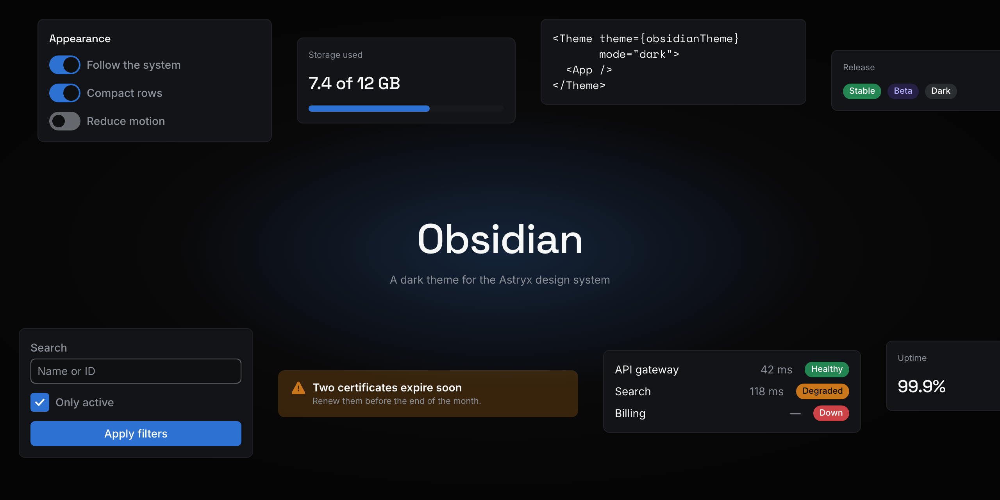
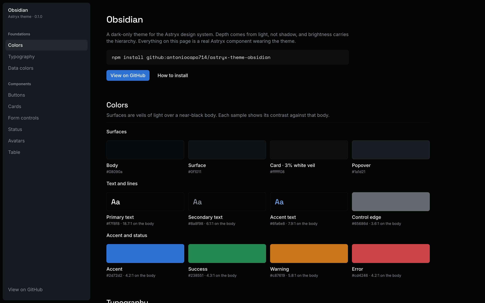
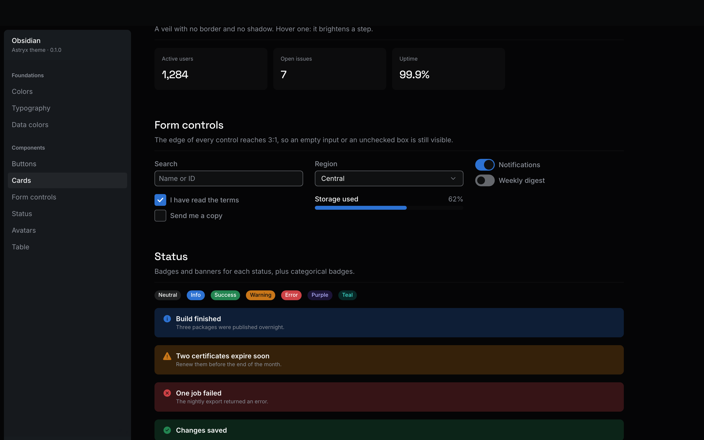

<p align="center">
  
</p>

<h1 align="center">Obsidian</h1>

<p align="center">
  A dark-only theme for the <a href="https://github.com/facebook/astryx">Astryx</a> design system,<br>
  built for dense, data-heavy interfaces.
</p>

<p align="center">
  <b>Version 0.2</b> · Built on <a href="https://github.com/facebook/astryx">Astryx 0.7</a> and <a href="https://react.dev">React 19+</a>
</p>

<p align="center">
  
  
  
  
</p>

<p align="center">
  <a href="https://creative-context.github.io/astryx-theme-obsidian/"></a>
</p>

<p align="center">
  <a href="https://creative-context.github.io/astryx-theme-obsidian/"><b>Live demo</b></a> ·
  <a href="#getting-started"><b>Getting started</b></a> ·
  <a href="#data-visualization"><b>Data visualization</b></a> ·
  <a href="#customize"><b>Customize</b></a> ·
  <a href="#ai-assistants"><b>AI assistants</b></a> ·
  <a href="CHANGELOG.md"><b>Changelog</b></a>
</p>

## Overview

Obsidian is a theme for Astryx, Meta's open source design system. It changes nothing in how you build: the same components, the same props, the same CLI. It changes how they look: near-black surfaces, depth made of light, and a strict brightness hierarchy that keeps dense screens readable.

The [live demo](https://creative-context.github.io/astryx-theme-obsidian/) shows every part of it on real Astryx components.

**What makes Obsidian different:**

- **Depth by light, not shadow.** Surfaces are translucent white veils over a near-black body, and each step up is a little more light: 2% for muted wells, 3% for cards, 4% on hover, 6% when selected. Cards never cast a shadow.
- **Brightness is the hierarchy.** Text comes in four steps, and the brightest is kept for the values and titles that matter. Hover and selection change brightness and veil together, with no coloured bars or accent tints.
- **Dark only, for real.** Every color is a single value, including the ones it inherits from Astryx, so nothing turns light when the system preference is light.
- **Accessible by contract.** Text reaches 4.5:1 on every surface, and the edge of every control reaches 3:1. A test suite enforces both, so a change that breaks them fails.
- **Charts that work in the dark.** Astryx's chart colors are refitted for a near-black surface and tested for colour-blind readers, with reference charts to copy.





## Getting started

Obsidian needs `@astryxdesign/core` 0.7 and React 19 or later. It is installed straight from this repository; it is not on the npm registry.

```bash
npm install github:creative-context/astryx-theme-obsidian#v0.2.0
npx astryx theme add obsidian --package astryx-theme-obsidian
```

`#v0.2.0` pins a [release](https://github.com/creative-context/astryx-theme-obsidian/releases); without it you get the tip of `main`.

`theme add` writes the imports for the built theme, its stylesheet and its fonts into your generated theme module. Apply it with `mode="dark"`:

```tsx
import {Theme} from '@astryxdesign/core/theme';
import {themes} from './astryx-themes';

<Theme theme={themes.obsidian} mode="dark">
  <App />
</Theme>
```

### Keep `@scope` in your production build

The theme ships as CSS `@scope` rules. esbuild, Vite's default CSS minifier, removes them without a warning, so the theme works in development and disappears in production. Use Lightning CSS:

```ts
// vite.config.ts
export default defineConfig({
  build: {cssMinify: 'lightningcss', cssTarget: ['chrome118', 'safari17', 'firefox128']},
});
```

`@scope` needs Chrome 118, Safari 17.4 or Firefox 128 or later.

### Page background

`AppShell` paints the page background. If a page doesn't use it, the browser's default dark grey shows around your content. Set it yourself:

```css
body {
  background: var(--color-background-body);
}
```

### Wiring it by hand

Without the CLI, import the built theme and its two stylesheets:

```tsx
import {Theme} from '@astryxdesign/core/theme';
import {obsidianTheme} from 'astryx-theme-obsidian/themes/obsidian';
import 'astryx-theme-obsidian/themes/obsidian.fonts.css';
import 'astryx-theme-obsidian/themes/obsidian.css';

<Theme theme={obsidianTheme} mode="dark">
  <App />
</Theme>
```

### AI assistants

Two files tell an AI assistant how to work with Obsidian:

- **[`llms.txt`](llms.txt)** is for an assistant building an app *with* the theme: how to install and apply it, the rules that matter (`mode="dark"`, Lightning CSS, the order of the chart colours), and which tokens to use. It ships in the package and is also published at [`/llms.txt`](https://creative-context.github.io/astryx-theme-obsidian/llms.txt) on the showcase.
- **[`AGENTS.md`](AGENTS.md)** is for an assistant working *on* this repository: the layout, which files are generated and must not be edited by hand, the commands, and the rule that the contrast tests are the contract. `CLAUDE.md` imports it.

Inside an Astryx app, an assistant can also read the theme's own doc topic with `npx astryx docs theme`.


## Colors

Contrast ratios are measured against the body (`#08090A`), a card and a popover.

| Role | Token | Value | Body | Card | Popover |
|---|---|---|---|---|---|
| Primary text | `--color-text-primary` | `#F7F8F8` | 18.7 | 17.8 | 15.9 |
| Secondary text | `--color-text-secondary` | `#8A8F98` | 6.1 | 5.8 | 5.2 |
| Accent text | `--color-text-accent` | `#6FA6E8` | 7.9 | 7.5 | 6.7 |
| Disabled text | `--color-text-disabled` | `#62666D` | 3.5 | 3.3 | 2.9 |
| Control edge | `--color-border-emphasized` | `#65686D` | 3.6 | 3.4 | 3.0 |
| Switch track | `--color-track` | `#65686D` | 3.6 | 3.4 | 3.0 |
| Accent, focus ring | `--color-accent` | `#2D72D2` | 4.2 | 4.0 | 3.6 |

| Filled control | Fill | Label | Contrast |
|---|---|---|---|
| Accent | `#2D72D2` | `#FFFFFF` | 4.7 |
| Success | `#238551` | `#FFFFFF` | 4.6 |
| Error | `#CD4246` | `#FFFFFF` | 4.7 |
| Warning | `#C87619` | `#0D0E10` | 5.6 |

## Data visualization

Astryx ships chart colors but no charts, and its default chart colors fail on a near-black body: orange and pink are too light for a dark surface, and pink and cyan become the same color for protanopic readers. Obsidian refits them and publishes all 56 data tokens, because Astryx 0.7 only emits the ones a theme sets.

**Categorical**, used in this order. Each keeps Astryx's hue; lightness and chroma are fitted by `scripts/fit-data-palette.mjs`.

| # | Token | Value |
|---|---|---|
| 1 | `--color-data-categorical-blue` | `#0A72E2` |
| 2 | `--color-data-categorical-orange` | `#E36A00` |
| 3 | `--color-data-categorical-purple` | `#6D25FF` |
| 4 | `--color-data-categorical-green` | `#0E9920` |
| 5 | `--color-data-categorical-pink` | `#B32C8B` |
| 6 | `--color-data-categorical-cyan` | `#0D9CE0` |
| 7 | `--color-data-categorical-red` | `#FE2A4B` |
| 8 | `--color-data-categorical-teal` | `#07A4A4` |
| 9 | `--color-data-categorical-brown` | `#965D01` |
| 10 | `--color-data-categorical-indigo` | `#6C87FC` |

In that order, neighbours stay at least ΔE 14 apart for protanopic and deuteranopic readers (OKLab ×100, Machado 2009 simulation) and 23 apart for everyone, and every color reaches 3:1 on the body and on a card. Past eight series, fold the rest into "Other" rather than reaching for the ninth and tenth.

**Sequential ramps** (`--color-data-<hue>-1` to `-5`, for blue, shamrock, orange, pink, purple, red, teal, yellow and gray) step from light to dark with a visible gap between steps. On this dark surface the anchor flips: step 5, the darkest, means *least*, and it still reaches 2:1 so it never disappears. Four of Astryx's steps were adjusted to get there.

**Charts.** The [demo](https://creative-context.github.io/astryx-theme-obsidian/#data) draws a line chart, a column chart and a heatmap in plain SVG against these tokens, so any chart library can copy the same decisions:

- marks carry the data colors; every word uses the text tokens;
- columns at most 24 px wide with a 4 px rounded end, square at the baseline;
- 2 px lines, 8 px end dots ringed in the surface color;
- hairline gridlines in `--color-border`;
- a legend whenever there are two or more series, plus direct labels at the line ends;
- a tooltip on hover and on keyboard focus, with the value first;
- a table behind every chart.

To feed the colors to D3, Vega or another JavaScript library, read them with Astryx's `useTheme()` hook. `test/dataviz.test.ts` checks the palette.

## Typography

| Role | Family | Notes |
|---|---|---|
| Body | Inter Variable | |
| Headings | Space Grotesk Variable | Weight 510, -0.02em tracking. |
| Code | Space Mono | |

The fonts are self-hosted through [Fontsource](https://fontsource.org) and loaded by `obsidian.fonts.css`. Inter and Space Grotesk must be the variable versions: the theme uses weight 510, and with static files the browser renders the 700 Bold instead.

The scale starts at 14 px with a ratio of 1.25. No size goes below 10 px, and the smallest heading is 11 px.

## Accessibility

- Text that carries meaning reaches 4.5:1 on every surface (WCAG 1.4.3).
- Anything that identifies a control or its state reaches 3:1: input edges, an unchecked checkbox, a switch that is off, and the focus ring (WCAG 1.4.11).
- Disabled text is exempt and measures 2.9–3.5:1.
- Plain dividers (`--color-border`) stay faint on purpose. They are decoration, so don't make one the only edge of something a user has to find.

## Customize

Extend the theme rather than copying it, so you keep receiving its fixes:

```ts
import {defineTheme} from '@astryxdesign/core/theme';
import {obsidianTheme} from 'astryx-theme-obsidian/themes/obsidian';

export const myTheme = defineTheme({
  name: 'my-theme',
  extends: obsidianTheme,
  tokens: {
    '--color-accent': '#7C5CFF',
  },
});
```

Build it with `npx astryx theme build`. If you change a color, check it against the tables above; `test/contrast.test.ts` shows how to measure it.

## Develop

```bash
bun install
bun run build         # themes/obsidian/obsidianTheme.ts → obsidian.css / .js / .d.ts
bun run demo          # the showcase at http://localhost:5173
bun run test          # contrast, token and chart-color tests
npx playwright test   # the theme as the browser renders it
```

After upgrading `@astryxdesign/core`, run `bun run bake` to refresh `themes/obsidian/darkDefaults.ts`, then `bun run build`. Every push to `main` runs the tests and publishes the showcase to GitHub Pages.

## License

[MIT](LICENSE)
